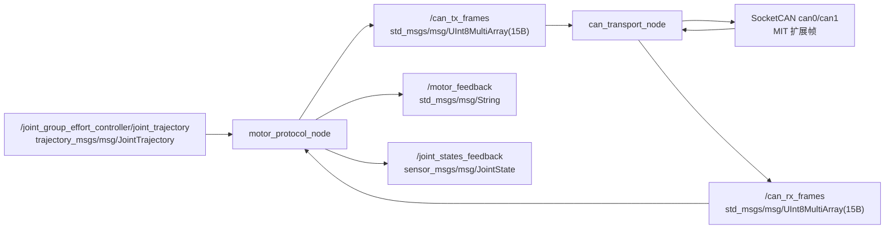
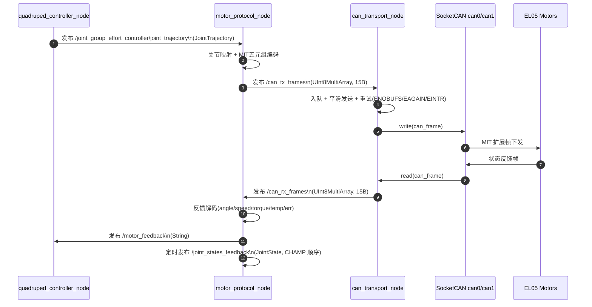

# CAN 桥架构与话题细节（MIT-only 双节点）

当前主链路采用两个节点解耦：

- `motor_protocol_node`：协议层，负责 `JointTrajectory -> MIT 五元组 CAN 帧` 编码，以及 RX 反馈解码
- `can_transport_node`：传输层，负责 `SocketCAN(can0/can1)` 的收发与 ROS 话题桥接

## 1) 总体 Mermaid 架构图



## 2) 端到端时序 Mermaid 图



## 3) 节点收发关系（按当前实现）

| 节点 | 订阅 Topic | 发布 Topic | 说明 |
|---|---|---|---|
| `motor_protocol_node` | `/joint_group_effort_controller/joint_trajectory` (`trajectory_msgs/msg/JointTrajectory`)、`/can_rx_frames` (`std_msgs/msg/UInt8MultiArray`) | `/can_tx_frames`、`/motor_feedback`、**`/joint_states_feedback`**（`sensor_msgs/msg/JointState`，定时 **`feedback_joint_states_timer_hz`** + CAN 缓存） | MIT 编码/解码；`enable_rx_decode_log` 仅影响字符串日志，不关闭反馈解析 |
| `can_transport_node` | `/can_tx_frames` (`std_msgs/msg/UInt8MultiArray`) | `/can_rx_frames` (`std_msgs/msg/UInt8MultiArray`) | 双通道 SocketCAN 收发（`can0/can1`），带发送队列、重试与 5 秒统计 |

## 4) Topic 消息类型与“实际消息”示例

### 4.1 输入轨迹：`/joint_group_effort_controller/joint_trajectory`

消息类型：`trajectory_msgs/msg/JointTrajectory`  
作用：上游控制器给出 12 关节目标角，`motor_protocol_node` 取 `points[0].positions` 进行 MIT 下发。

示例（简化）：

```yaml
header:
  frame_id: ""
joint_names: [lf_hip_joint, lf_upper_leg_joint, lf_lower_leg_joint, rf_hip_joint, ...]
points:
  - positions: [0.10, -0.45, 0.90, -0.10, -0.45, 0.90, 0.10, -0.45, 0.90, -0.10, -0.45, 0.90]
    velocities: []
    accelerations: []
    effort: []
    time_from_start: {sec: 0, nanosec: 20000000}
```

### 4.2 协议桥接帧：`/can_tx_frames` 与 `/can_rx_frames`

消息类型：`std_msgs/msg/UInt8MultiArray`  
当前固定长度：15 字节，编码定义如下：

- `[0]` `bus`：`0=can0, 1=can1`
- `[1]` `is_extended`：`0/1`
- `[2]` `dlc`
- `[3..6]` `can_id`（大端）
- `[7..14]` `data[8]`

示例（来自日志的一帧，`can1 id=0x17fff35 dlc=8 data=[117 75 127 255 15 92 76 204]`）：

```yaml
layout:
  dim: []
  data_offset: 0
data: [1, 1, 8, 0x01, 0x7f, 0xff, 0x35, 117, 75, 127, 255, 15, 92, 76, 204]
```

### 4.3 反馈解析：`/motor_feedback`

消息类型：`std_msgs/msg/String`  
作用：`motor_protocol_node` 把 `/can_rx_frames` 解码后发布文本反馈，便于快速观测联调。

示例：

```text
bus=1 motor=53 mode=1 angle=0.123 speed=-0.045 torque=0.210 temp=36 err=0
```

### 4.4 CHAMP 反馈关节态：`/joint_states_feedback`

消息类型：`sensor_msgs/msg/JointState`  
作用：将 EL05 反馈角反解到 CHAMP/URDF 关节名顺序，供 **`robot_state_publisher_feedback`**（TF 前缀 `fb/`）与 RViz **`RobotModelFeedback`**。  
发布节奏：参数 **`feedback_joint_states_timer_hz`**（默认约 50Hz）定时发布；数值在 CAN 反馈到达时更新缓存。  
与 **`enable_rx_decode_log`**：关闭后者仍会解码并更新反馈角，仅减少 `/motor_feedback` 与解码 INFO（见 [`开发问题跟踪.md`](./开发问题跟踪.md) ISSUE-0005）。

### 4.5 单行十六进制可读输出：`/can_frames_tx_line`、`/can_frames_rx_line`（可选）

`/can_tx_frames` / `/can_rx_frames` 仍是 `UInt8MultiArray`（15 字节打包），`ros2 topic echo` 默认按十进制列出 `data`，可读性一般。

在 `can_transport_node` 中可开启 **`publish_hex_lines`**（默认关闭），按方向拆成两个 **`std_msgs/msg/String`** 话题，一行包含 **TX/RX、总线、标准/扩展、CAN ID、DLC、payload（十六进制）**，便于分开 `echo`：

```text
TX can1 EXT id=0x017FFF0D len=08 75 4B 7F FF 0F 5C 4C CC
RX can0 EXT id=0x027FFF0B len=08 ...
```

启用方式（编辑 `src/trotbot_can_bridge/config/bridge.yaml`）：

```yaml
publish_hex_lines: true
hex_tx_line_topic: /can_frames_tx_line
hex_rx_line_topic: /can_frames_rx_line
```

观察：

```bash
ros2 topic echo /can_frames_tx_line
ros2 topic echo /can_frames_rx_line
```

> 注意：开启后 Tx+Rx 合计可达数千行/秒，仅建议在短时抓包或降 `loop_rate` 时使用。

## 5) 运行时统计日志说明（can_transport_node）

每 5 秒输出一次发送统计：

```text
TX stats(5s): enq=7779 ok=7779 fail=68 retry_fail=68 retry_ok=24 drop_overflow=0 drop_non_retry=0 drop_retry_exceeded=0 queue=0 fail_rate=0.87% retry_frame_ok_rate=100.00%
CAN bus counts(5s): tx_can0=6000 tx_can1=6000 rx_can0=6000 rx_can1=6000 | two-wire ping-pong check (expect ~0): (tx_can0-rx_can1)=0 (tx_can1-rx_can0)=0
```

字段解释：

- `enq`：入队帧数
- `ok`：成功发送次数（写 SocketCAN 成功）
- `fail`：发送失败尝试次数（可重试+不可重试）
- `retry_fail`：可重试失败次数（如 `ENOBUFS/EAGAIN/EINTR`）
- `retry_ok`：经历过至少一次失败后最终发送成功的帧数
- `drop_overflow`：队列满导致丢弃数
- `drop_non_retry`：不可重试错误导致丢弃数
- `drop_retry_exceeded`：超过最大重试次数导致丢弃数
- `queue`：当前待发送队列长度
- `fail_rate`：失败尝试率，`fail / (ok + fail)`
- `retry_frame_ok_rate`：重试帧成功率，`retry_ok / 需要重试的帧数`

`CAN bus counts(5s)`：

- `tx_can0 / tx_can1`：过去 5 秒内各成功写入 SocketCAN 的下发帧数。
- `rx_can0 / rx_can1`：过去 5 秒内各控制器读到的接收帧数。
- `two-wire ping-pong check`：**(tx_can0 − rx_can1)** 与 **(tx_can1 − rx_can0)**。两片 CAN **点对点直连**（一侧发线进另一侧收）时，一般会看到一侧发出的帧在对侧收到，两项差值应接近 **0**。
- 若两片接口挂在**同一公共总线段**（多节点、两端终端电阻等），各路 RX 可能都能看到总线上几乎全部报文，`tx_*` 与“对侧 `rx_*`”未必一一配对，该项仅作定性参考。

说明：`retry_fail - retry_ok` 不能直接当作最终丢帧数，最终丢帧请看三个 `drop_*` 字段。

## 6) 单独启动与参数覆盖

接口名与默认配置不一致时（例如设备树里是 `can2` 映射成 `can1`），可覆盖：

```bash
ros2 launch trotbot_can_bridge can_bridge.launch.py can0_name:=can0 can1_name:=can1
```

使用自定义参数文件（例如打开十六进制行、调发送队列）：

```bash
ros2 launch trotbot_can_bridge can_bridge.launch.py \
  bridge_file:=/home/cat/trotbot_ws/src/trotbot_can_bridge/config/bridge.yaml \
  gains_file:=/home/cat/trotbot_ws/src/trotbot_can_bridge/config/control_gains.yaml
```

说明：

- **`motor_protocol_node`** 仍订阅 `/joint_group_effort_controller/joint_trajectory`。本启动里**没有** CHAMP 时，该话题默认无人发布，总线上不会有 MIT 下发；若要产生报文，需自行往该话题发一条 `JointTrajectory`，或改用下面「只跑传输层」。
- **只测 SocketCAN 收发**（不需要 MIT 编码）时，可只启动传输节点，并直接向 `/can_tx_frames` 发 15 字节打包帧（与 `FrameCodec` 约定一致），或在另一终端用 `candump` / `cansend` 对照。

```bash
source /opt/ros/humble/setup.bash
source /home/cat/trotbot_ws/install/setup.bash
ros2 run trotbot_can_bridge can_transport_node --ros-args \
  --params-file /home/cat/trotbot_ws/src/trotbot_can_bridge/config/bridge.yaml
```
