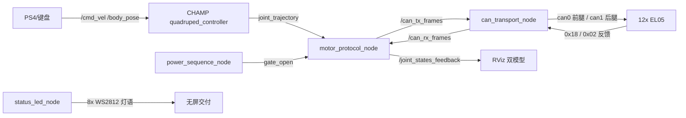

# TrotBot 机器狗开发路线（对标行业 L0-L5）

> 本文档回答三个问题：**行业机器狗按什么顺序长能力**、**本仓已经走到哪一步**、**下一步（含本周）该做什么**。  
> 状态判定以本仓代码与 `declare_parameter` 为准；与旧文档冲突时以代码为准。  
> 关联文档：[软件需求清单.md](./软件需求清单.md)（RQ 条目与验收）、[架构说明.md](./架构说明.md)（节点/话题/数据流）、[开发问题跟踪.md](./开发问题跟踪.md)（ISSUE 闭环）。
>
> 最后更新：2026-11-04

---

## 0. 文档定位与图例

| 文档 | 回答的问题 | 本文与它的关系 |
|---|---|---|
| `软件需求清单.md` | 有哪些需求、做到什么程度算完成 | 本文按能力层引用 RQ 编号，不重复验收条目 |
| `架构说明.md` | 现在怎么实现、话题怎么流 | 本文只描述能力目标与差距，不复制节点细节 |
| `开发问题跟踪.md` | 出了什么问题、怎么闭环 | 本文引用 ISSUE 结论作为状态证据 |

**状态图例**

- ✅ 已完成：代码已实现，且在实机/仿真链路中可用
- 🟡 部分完成：主链路可用，但缺关键环节（参数化、闭环、验证或运维手段）
- ⬜ 未开始：仓库内无实现或只有骨架

**用法**：先看 §2 一页看板判断当前位置，再用 §3 找该层的差距，最后按 §4/§5 决定下一步与本周动作。

---

## 1. 行业对标：四足能力分层 L0-L5

分层原则：**下层不闭环，上层不成立**。行业产品（消费级 Go2 / CyberDog 2 / Lite3，工业级 Spot / X30）能力栈基本一致，差异更多在传感器与算力级别，而非控制链路本身。

| 层级 | 能力目标 | 行业常见做法 | 可验收标志 |
|---|---|---|---|
| **L0 硬件与通信底座** | 12 自由度关节、稳定总线、供电与指示、板载计算 | 准直驱/行星减速关节 + CAN/EtherCAT；IMU 标配；BMS 与硬件急停；灯语/蜂鸣提示状态；出厂标定数据随整机 | 12 电机可长期稳定收发；断线/掉帧可观测；开机即可判断「是否就绪」 |
| **L1 关节级控制与标定** | MIT 阻抗控制、零位/方向/限位标定、单腿验证、力矩口径 | 出厂逐关节标定；电流-力矩一致性校准；摩擦/惯量辨识；单腿正弦跟踪测试 | 单腿正弦跟踪无明显滞后；静态保持误差可控；力矩方向与指令一致 |
| **L2 整机安全与启停编排** | 上/下电状态机、轨迹门禁、急停、失联降级、故障注入 | 硬件急停 + 软件看门狗 + BMS 联锁；Fault 态可锁存与恢复；上下电顺序固定 | 任意时刻可安全停机；故障注入后进入 Fault 并失能；恢复条件明确 |
| **L3 基础运动与步态** | 站/趴、姿态（roll/pitch/yaw/高度）、速度控制、trot、慢速 walk、步态切换 | 多步态（walk/trot/pace/bound）；步态参数在线可调；转向与横移；遥控/App 双入口 | 0.1–0.5 m/s 直线与转向可跟踪；步态切换无冲击；参数改动可复现 |
| **L4 状态估计与地形适应** | IMU 姿态、腿部运动学里程计、足端接触、坡道/不平地面 | IMU + 关节 + 足端融合；消费级加激光/视觉做地形感知；工业级做坡度与越障策略 | 姿态估计误差有量化指标；坡道/台阶通过率可统计；打滑可被识别 |
| **L5 动力学与高级运动** | 重力/摩擦补偿、WBC/MPC、跑跳、楼梯、跌倒恢复 | 模型前馈 + 全身控制；高阶用 MPC/TSID；跑跳与越障为旗舰能力 | 站立下沉量、轨迹跟踪误差、越障成功率可对比 |
| **L6+ 延伸层（不在本仓当前范围）** | 感知、SLAM、导航、跟随、语音、App/OTA | 激光/视觉 SLAM + 导航栈；端侧 AI；云平台 | 自主建图导航、目标跟随、远程升级 |

**对标结论（本仓视角）**

1. 本仓的**优势在 L0-L2 工程闭环**：双 CAN 协议、零位与 `zero_sta` 处理、上/下电状态机、门禁与反馈校验，这些是很多自研狗最容易出安全事故的环节，本仓已经做成可复现流程。
2. **主要差距在 L4-L5**：没有 IMU 姿态闭环、没有随位形变化的模型重力前馈、没有多步态与动态运动。这决定了「能走」和「走得稳、能加难度」之间的分界。
3. 传感器是硬约束：L4 以上的地形适应与 L6+ 的感知导航，前提是 IMU/足端力/雷达/相机到位；没有硬件时只能做算法骨架，不能宣称完成。
4. 对标不是参数竞赛：消费级的高速度/空翻属于 L5 旗舰项，对当前阶段的收益远低于「站立稳、慢走准、可安全停机」。

---

## 2. 本仓现状看板

### 2.1 完成度总表

| 层级 | 完成度（估算） | 状态 | 关键证据 | 主要缺口 |
|---|---|---|---|---|
| L0 硬件与通信 | ~85% | ✅ | `trotbot_can_bridge/src/can_transport_node.cpp`、`socketcan_driver.cpp`、`include/trotbot_can_bridge/protocol_codec.hpp`、`config/motor_map.yaml`；WS2812 灯语见 `src/trotbot_status_led/`（RQ-023） | 无电池/电压电流监控；无硬件急停回路；自启仅示例单元 `src/trotbot/config/systemd/trotbot-basic.service.example` |
| L1 关节控制与标定 | ~80% | ✅ | RQ-001～006、RQ-009/010/016/017/018、RQ-024；`dog_mapper.hpp`、`motor_protocol_node.cpp`、`scripts/el05_motor_cansend.sh` | 无摩擦/阻尼与惯量辨识；力矩标定仅靠实测静态表，无电流-力矩一致性验证 |
| L2 安全与启停 | ~65% | 🟡 | RQ-007/008/012/013；`power_sequence_node.cpp`、`config/power_sequence.yaml`、`motor_monitor_node.cpp` | 无独立 `safety_manager`（急停/越限/超时/恢复，RQ-020 未立项）；Fault 分支未闭环；总线 bus-off/电机失联只告警不降级；无故障注入测试 |
| L3 基础运动与步态 | ~55% | 🟡 | CHAMP `quadruped_controller_node` + `gait_minidog.yaml`（`loop_rate: 50Hz`）；`champ_teleop.py` 手柄/键盘；RQ-011 双模型 RViz | 仅一组 trot 参数；无 walk/pace/bound 与步态切换；步态参数靠人工试凑；无标准测试场景 |
| L4 状态估计与地形 | ~10% | ⬜ | `has_imu` 默认 `false`（`champ_controllers.launch.py`、`trotbot_basic.launch.py`）；CHAMP 开环运动学里程计（`odom_scaler`） | 无 IMU 姿态融合；无足端接触/力估计；无坡道与不平地面策略 |
| L5 动力学与高级运动 | ~20% | 🟡 | RQ-022 静态重力前馈表（`control_gains.yaml` 中 12 维 `tau_ff_nominal_nm` 已填实测值，默认关闭） | RQ-025 模型重力前馈未实现（`src/trotbot_dynamics/` 仅 `package.xml`/`CMakeLists.txt`/`config`，缺 `src/pinocchio_tau_ff_node.cpp` 与 launch，`motor_protocol_node` 无 `/model_tau_ff` 订阅）；无 WBC/MPC；无跑跳/楼梯/越障 |
| L6+ 延伸层 | 0% | ⬜ | `src/champ/champ_navigation/` 仅模板 launch | 未接入整机 launch，无雷达/相机硬件 |

### 2.2 已闭环的链路

- **控制链**：`/cmd_vel` → CHAMP 轨迹 → MIT 帧 → CAN → 电机反馈 → RViz，频率与丢帧问题已在 ISSUE-0002 闭环（QoS + 限频）。
- **安全链**：`L3` 上电、`□` 站起、`○` 趴下、`R3` 失能、未上电 `L1+R1` 设零（ISSUE-PS4-005），门禁未开时轨迹不透传。
- **标定链**：一次性 `motor_init`（set_zero + `zero_sta=1` + 存 flash + 回读），解决 ISSUE-0003 的绕圈回零。

**结论**：本仓已跨过「底盘能不能动」阶段，进入「动作质量与可维护性」阶段；接下来收益最高的是**动力学补偿**与**状态估计**，而不是继续堆功能入口。

---

## 3. 逐层路线

每层按「目标 → 行业做法 → 本仓现状 → 差距与风险 → 验收（DoD） → 依赖」展开。

### 3.1 L0 硬件与通信底座

- **目标**：12 关节长期稳定收发；总线异常可观测；开机即可判断是否就绪。
- **行业做法**：多总线冗余、驱动器状态字、BMS 联锁、硬件急停、灯语/蜂鸣。
- **本仓现状**：双 CAN 1Mbps、EL05 协议编解码、主动上报、灯语均已落地（✅）；自启只有示例单元，未装机（🟡）。
- **差距与风险**：
  - 无电池电压/电流/温度监控 → 无法做低电量保护与功耗评估。
  - 无硬件急停回路 → 软件失能是唯一手段，CAN 堵塞时存在风险。
  - bus-off 只统计不降级（`can_transport_node.cpp` 统计日志）。
- **DoD**：总线异常能在 100 ms 内被上层感知并停止轨迹；电池状态有话题/日志；急停方案（硬件或软件）有明确入口与验证记录。
- **依赖**：硬件（BMS/急停按钮）、电气方案确认。

### 3.2 L1 关节级控制与标定

- **目标**：单关节可独立验证；零位/方向/限位/力矩口径一致。
- **行业做法**：出厂逐关节标定；电流-力矩一致性校准；摩擦/惯量辨识；单腿正弦跟踪。
- **本仓现状**：关节映射、sign/offset、限位、MIT 参数化、在线调参、零位与 `zero_sta` 均已落地（✅）；`tau_ff_nominal_nm` 为实测静态表（🟡）。
- **差距与风险**：
  - 力矩口径未做「指令-反馈」一致性验证，重力补偿的符号与增益缺少可信基准。
  - 无摩擦/惯量辨识，后续 WBC/MPC 缺少模型参数。
  - 机械间隙与标定精度会直接吃掉 L5 的补偿收益。
- **DoD**：单腿正弦跟踪有误差曲线；同一关节正反方向力矩指令-反馈符号一致；标定后静置 5 min 位置漂移可量化。
- **依赖**：零位工装、单腿测试支架。

### 3.3 L2 整机安全与启停编排

- **目标**：任意时刻可安全停机；故障可锁存、可恢复、可追溯。
- **行业做法**：硬件急停 + 软件看门狗 + BMS 联锁；统一 Fault 态；故障注入回归。
- **本仓现状**：状态机（Idle/Precheck/EnableInit/SoftStand/Running/SoftProne/ProneHold/Disable/Fault）、门禁、反馈新鲜度校验、趴下保持与失能拆分均已落地（✅）；Fault 分支与失联降级未闭环（🟡）。
- **差距与风险**：
  - 缺 `safety_manager_node`：急停、越限、超时、恢复条件分散在 `motor_protocol_node` 与 `power_sequence_node`（`架构说明.md` §3 仍标「建议新增」，RQ-020 未立项）。
  - 电机故障位已有 `/diagnostics`，但未驱动状态机降级。
  - 缺故障注入测试，回归依赖人工。
- **DoD**：
  1. 单电机故障位/反馈超时 → 进 Fault 并失能，日志含原因；
  2. 软件急停入口（手柄组合或话题）在 Running 下 ≤1 s 生效；
  3. 故障注入脚本可重复执行。
- **依赖**：无硬件新增；需明确「Fault 后是否允许原地恢复」的产品口径。

### 3.4 L3 基础运动与步态

- **目标**：站/趴/姿态可控；trot 稳定；有慢速 walk 应对窄空间；步态可切换。
- **行业做法**：多步态 + 参数在线可调 + 遥控/App 双入口；步态切换做相位与高度过渡。
- **本仓现状**：CHAMP trot、速度与 body_pose 控制、手柄/键盘遥控、双模型可视化已落地（✅）；单一步态、参数手工调（🟡）。
- **差距与风险**：
  - `gait_minidog.yaml` 只有一组参数，不同地面/负载需手工改 YAML 重启。
  - 无 walk 慢速步态，窄空间与精细对位能力弱。
  - `loop_rate: 50Hz` 下动态性能上限有限，提频前需先做 L1/L5 的力矩与补偿基础。
- **DoD**：0.1–0.2 m/s（当前 `max_linear_velocity_x` 上限）直线与转向有跟踪误差数据；步态参数在线可调且可回滚；walk/trot 切换无冲击。
- **依赖**：地面测试场地、可重复的测速/测角方法。

### 3.5 L4 状态估计与地形适应

- **目标**：知道自己是「什么姿态、走了多远、脚踩没踩实」。
- **行业做法**：IMU + 关节运动学 + 足端接触融合；消费级叠加激光/视觉地形感知。
- **本仓现状**：`has_imu` 默认 `false`，仅 CHAMP 开环里程计（⬜）。
- **差距与风险**：
  - 无姿态反馈 → 坡道、单腿打滑、外力扰动都无法识别；body_pose 的 roll/pitch 只是开环指令。
  - 无足端接触 → 摆动相/支撑相全靠时间开环，地面不平即失配。
  - 定基重力模型（RQ-025）在机体倾斜时误差会放大，这也是必须先补 IMU 的原因。
- **DoD**：IMU 接入后 roll/pitch 估计误差可量化（静态与动态）；足端接触判定与实测一致率有统计；坡道通过有记录。
- **依赖**：**IMU 硬件是否已装**是首要阻塞项；其次是足端传感或电流-based 接触估计方案。

### 3.6 L5 动力学与高级运动

- **目标**：把「位置误差承担自重」变成「前馈承担自重」，再走向全身控制。
- **行业做法**：模型前馈（重力/科氏/摩擦）+ WBC/MPC；旗舰机做跑跳、楼梯、跌倒恢复。
- **本仓现状**：
  - ✅ RQ-022 静态重力前馈表（12 维实测值，`gravity_ff_scale` 默认 0.5，总开关默认 **off**）。
  - ⬜ RQ-025 模型重力前馈：`trotbot_dynamics` 仅有包骨架，节点与 launch 缺失；`motor_protocol_node` 无 `/model_tau_ff` 订阅。
  - ⬜ 摩擦/惯量辨识、WBC/MPC、跑跳/楼梯/越障。
- **差距与风险**：
  - 静态表只在标定姿态成立，姿态变化后失配；模型前馈才能随 `q` 变化。
  - 符号错误会形成正反馈、加重下塌；必须逐关节小增益验证。
  - 定基模型忽略机体 roll/pitch，需与 L4 的 IMU 进度配合。
- **DoD（分两段）**：
  1. 静态前馈：开启前后站立/慢走的关节误差、机体下沉量有 A/B 数据，且可一键回退。
  2. 模型前馈：`/model_tau_ff` 频率与数值正确（离线对拍）、超时回落无阶跃、实机增益阶梯验证通过。
- **依赖**：L1 力矩口径、L4 姿态信息、实机调参窗口。

### 3.7 L6+ 延伸层（明确不做）

感知、SLAM、导航、跟随、语音、App/OTA。当前仅 `champ_navigation` 模板 launch，未接入整机，也没有雷达/相机。**在本仓 L2-L5 闭环前不投入**；若产品需要，先立需求并确认硬件选型。

---

## 4. 分阶段路线图

| 阶段 | 定位 | 内容 | 出口标准 |
|---|---|---|---|
| **M0（已完成）** | 能动 | L0 通信底座、L1 关节控制与标定、L2 启停状态机、L3 基础 trot、RViz 双模型、灯语 | 遥控可完成上电→站→走→趴→下电全流程 |
| **M1（本周）** | 走得稳 | 重力补偿闭环（静态前馈 A/B + 模型前馈准备）、稳定性基线、安全兜底条目化 | 有「开启/关闭重力补偿」的量化对比与结论 |
| **M2（近期）** | 感知自身 | L2 安全加固（`safety_manager` 最小版、Fault 闭环、失联降级）、L4 IMU 接入、L3 步态参数在线化 | 故障注入可复现；IMU 姿态有数据；步态参数免重启 |
| **M3（中期）** | 适应地面 | L4 足端接触/地形适应、L5 摩擦与惯量辨识、多步态（walk） | 坡道/不平地面通过率有统计 |
| **M4（远期）** | 动态与自主 | L5 WBC/MPC、跑跳/越障、L6+ 感知导航 | 动态动作成功率；导航闭环 |

> 阶段只表达**先后依赖**，不承诺工期。M1 之后每一阶段的入口都是上一阶段的量化基线。

---

## 5. 本周优先事项（建议，尚未实施）

### 5.1 第一优先：重力补偿闭环

**为什么它相对重要（回答「重力补偿是不是挺重要」）**

1. 当前是 **MIT 位置控制 + 50 Hz 轨迹**：机体自重完全由 `kp·(q_des − q)` 的位置误差承担。这直接导致静态下塌、跟踪误差，以及为压住误差而把 `kp` 调大 → 发热、振荡、噪声。
2. 前馈是**乘数效应**：同样的 `kp` 下，误差变小；或同样的误差下，`kp` 可下调。它对站立、慢走、转向全部生效，收益面比单一功能大。
3. 它是**后续能力的地基**：没有重力/摩擦补偿，walk、坡道、WBC/MPC 都缺少可信的力矩基线；先做补偿，后面每一步都更省事。
4. 本仓已具备**低成本起点**：RQ-022 的 12 维实测表已在 `control_gains.yaml` 里，只差开启与验证；模型版（RQ-025）包骨架也已存在，属于「补齐」而不是「从零造」。

**但要按顺序做，否则会反噬**：位置控制下符号错=正反馈，会加重下塌；静态表在姿态变化后失配。所以本周顺序是「先测基线 → 再小增益开启 → 最后才谈模型前馈」。

**本周动作**

1. 用 `motor_monitor_node`（`/motor_feedback` → 力矩/位置日志）建立**基线**：站立 30 s、慢走 20 s，记录 12 关节位置误差、力矩均值/峰值、电机温度。
2. 开启 RQ-022：`enable_joint_tau_ff=true`，`gravity_ff_scale` 从 **0.2** 起，逐级 0.35 / 0.5；每级重复同一测试，记录同样指标。
3. 逐关节核对方向：某关节误差变大 → 只翻转该路 `tau_ff_nominal_nm` 符号，不做整体取反。
4. 形成一页对比结论（含「建议默认值」与「是否继续上模型前馈」）。
5. 把符号与增益口径记入 `开发问题跟踪.md`，作为 RQ-025 的输入。

**验收**

- 有开启/关闭两组同场景数据，关节误差或机体下沉量至少一项改善；
- 任意时刻可 `ros2 param set /motor_protocol_node enable_joint_tau_ff false` 一键回退；
- 温度与力矩峰值不超安全阈值，无振荡。

**风险**

- 静态表不随姿态变化：趴姿/蹲姿下可能失配，需按姿态分段评估；
- 若 URDF 质量参数与实机差异大，模型版收益会被抵消（先查 URDF 质量/惯量来源）。

### 5.2 第二优先：站立/慢走稳定性基线

- **目标**：给「稳不稳」一个可重复的定义，避免每次靠体感判断。
- **动作**：固定场地、固定电量区间、固定测试序列（趴→站→慢走→停→趴），记录关节误差、机体高度、温度、力矩；脚本化采集，结果存 `doc_analysis/` 同类目录。
- **验收**：同一配置连续 3 次测试的指标波动可接受；他人可按文档复现。
- **依赖**：无新增硬件；需约定测试场地与安全工装。

### 5.3 第三优先：安全兜底条目化

- **目标**：在引入动力学补偿前，先明确「出问题怎么停」。
- **动作**：把软件急停、失联降级、Fault 恢复条件写成需求条目（对应 RQ-020），给出 DoD 与影响面；本周只做条目化与方案评审，不写代码。
- **验收**：需求条目可评审、可与 `power_sequence` 状态机对齐；明确「谁在什么条件下失能」。
- **依赖**：产品口径（Fault 后是否允许原地恢复）。

> 排序理由：重力补偿直接决定动作质量且已有低成本起点；稳定性基线是验证它的前提；安全兜底是继续加动力学能力的前置条件。三者都不依赖新硬件（IMU 除外，见 §6）。

---

## 6. 风险与依赖

| 类别 | 风险/依赖 | 影响 | 应对 |
|---|---|---|---|
| 硬件 | **IMU 是否已装未确认**（`has_imu` 默认 false） | L4 无法启动；定基重力模型在倾斜时误差放大 | 先确认硬件；无 IMU 时模型前馈明确标注「仅水平假设」 |
| 硬件 | 无电池/电流监控 | 无法评估功耗与低电量保护 | 加 BMS 或至少电压采样 |
| 硬件 | 无硬件急停 | CAN 异常时只能靠软件失能 | 优先做软件看门狗，硬件急停列入 BOM |
| 机械 | 关节间隙、零位重复性 | 抵消重力补偿收益，放大步态抖动 | 标定后量化漂移；必要时机械整改 |
| 算法 | URDF 质量/惯量与实机不符 | 模型前馈偏差大甚至反向 | 质量实测/辨识；`scale<1` + 斜坡 + 默认关闭 |
| 算法 | 符号错误 | 正反馈、加重下塌 | 逐关节验证，禁止整体取反 |
| 流程 | 单人联调窗口、实机占用 | 测试不可重复 | 固定测试脚本与记录模板 |
| 文档 | 需求/架构/路线三处状态漂移 | 决策依据失真 | 状态变更同步 `软件需求清单.md` 与本文 §2 |

---

## 7. 附录

### 7.1 RQ 与能力层映射

| RQ | 层级 | 状态 | 标题 |
|---|---|---|---|
| RQ-001～006 | L1 | ✅ | 关节映射、方向/偏移、限位、反馈反解 |
| RQ-007/008 | L2 | ✅ | 上电初始化、下电收拢编排 |
| RQ-009/010 | L1 | ✅ | MIT 参数化、镜像参数展开 |
| RQ-011 | L3 | ✅ | RViz 双模型 |
| RQ-012 | L2 | ✅ | 反馈结构化（速度/力矩/故障位） |
| RQ-013 | L2 | ✅ | 手柄上/下电 |
| RQ-014/015 | L1/运维 | ✅ | 标定档案与运行指南 |
| RQ-016/017/018 | L1/L2 | ✅ | 在线调参、平滑、步进限幅 |
| RQ-019 | L3 | ⬜ 候选 | 指令态 `cmd_joint_states` |
| RQ-020 | L2 | ⬜ 候选 | 安全管理节点/模块（急停、越限、超时） |
| RQ-021 | L2 | ⬜ 候选 | 标准 `/diagnostics` 聚合 |
| RQ-022 | L5 | ✅ | 静态重力/前馈力矩表 |
| RQ-023 | L0/L2 | ✅ | WS2812 灯语 |
| RQ-024 | L1 | ✅ | 遥控一次性机械零位 |
| RQ-025 | L5 | ⬜ | Pinocchio 模型重力前馈 |

### 7.2 术语

| 术语 | 含义 |
|---|---|
| MIT 控制 | 电机位置/速度/力矩 + kp/kd 的阻抗控制帧格式 |
| `tau_ff` | MIT 帧中的前馈力矩，用于抵消重力/动力学负载 |
| `zero_sta` | EL05 上电位置域参数（`0`：0~2π；`1`：−π~π） |
| RNE | 递归牛顿-欧拉逆动力学，`computeGeneralizedGravity` 为其静力特例 |
| WBC | 全身控制（Whole-Body Control），把任务与约束统一成优化问题 |
| MPC | 模型预测控制，滚动优化未来若干步的控制量 |
| 定基/浮基 | 动力学模型是否把机身当作固定基座（定基忽略机体 6 自由度运动） |

---

## 8. 维护约定

1. 新增能力先补 `软件需求清单.md` 的 RQ 条目，再更新本文对应层级的「本仓现状」与 §2 看板。
2. 任何状态从 ⬜/🟡 变 ✅，必须附带可复查的证据（话题、日志、测试记录），不写「已实现」而无依据。
3. 阶段推进（M1→M2）以 §5 的验收结果为准，不以时间点为准。
4. 与 `架构说明.md` 冲突时：能力描述以本文为准，节点/话题细节以 `架构说明.md` 为准，并同步修正。
